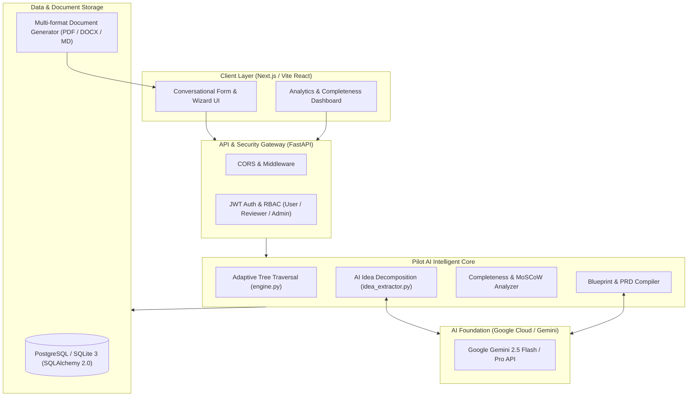

<p align="center">
  <a href="https://github.com/nanthishvaran17/pilot-ai">
    
  </a>
</p>

<h1 align="center">🚀 Pilot AI</h1>

<p align="center">
  <strong>Next-Generation Autonomous Requirements Engineering & Intelligent Project Blueprint Platform</strong>
</p>

<p align="center">
  <em>Transform vague, unstructured ideas into production-grade Software Requirement Specifications (SRS), Architecture Blueprints, and MoSCoW Roadmaps in seconds.</em>
</p>

<p align="center">
  <a href="https://github.com/nanthishvaran17/pilot-ai/actions"></a>
  <a href="https://fastapi.tiangolo.com/"></a>
  <a href="https://www.python.org/"></a>
  <a href="https://ai.google.dev/"></a>
  <a href="https://www.sqlalchemy.org/"></a>
  <a href="https://github.com/nanthishvaran17/pilot-ai/blob/main/LICENSE"></a>
</p>

---

## 📑 Table of Contents

- [Overview](#-overview)
- [Why Pilot AI? (The Problem vs Solution)](#-why-pilot-ai)
- [System Architecture](#-system-architecture)
- [Core Engineering Highlights](#-core-engineering-highlights)
- [Interactive API Endpoints](#-interactive-api-endpoints)
- [Master Product Roadmap](#-master-product-roadmap)
- [Quick Start & Installation](#-quick-start--installation)
- [Environment Configuration](#-environment-configuration)
- [Contributing & License](#-contributing--license)

---

## 🌟 Overview

**Pilot AI** is an enterprise-grade AI requirements engineering system designed to eliminate project planning friction for engineering teams, product managers, and agencies. 

Unlike traditional static questionnaires (Google Forms, Typeform) or generic LLM prompts that invent hallucinated specifications, Pilot AI leverages:
1. **Dynamic Adaptive Intake Engine**: Dynamically prunes irrelevant technical questions based on domain, user skill level, and previous answers.
2. **Deterministic & Non-Destructive Inferences**: Clearly delineates between *User-Confirmed Inputs*, *AI Recommendations*, and *Unresolved Decisions*.
3. **MoSCoW Prioritization Engine**: Categorizes features into **Must Have**, **Should Have**, **Could Have**, and **Won't Have** with automated ROI & complexity heuristics.
4. **Multi-Format Technical Exporter**: Instant generation of engineering PRDs, User Stories, and Architecture specs in PDF, Word (.docx), and Markdown.

---

## ⚡ Why Pilot AI?

| Feature Dimension | Traditional Methods (Typeform, Google Forms) | Generic LLMs (ChatGPT / Claude Prompts) | 🚀 **Pilot AI Platform** |
| :--- | :--- | :--- | :--- |
| **Question Flow** | Static 15-page wall of un-customized questions | Unstructured conversation without validation | **Smart Adaptive Tree**: Only asks what is contextually relevant |
| **Completeness** | Leaves major technical blindspots | Hallucinates architecture without constraints | **Deterministic Completeness Score (0-100%)** |
| **Decision Tracking** | Cannot flag undecided architecture choices | Makes silent assumptions | **Explicit Risk & Unresolved Decision Register** |
| **Deliverables** | Raw spreadsheet rows | Plain unstructured text | **Executive PRD, User Stories, & Mermaid Architecture** |
| **Security & Auditing** | None | Public prompt exposure | **Enterprise RBAC, JWT Auth, and Audit Trails** |

---

## 🏗️ System Architecture



---

## 🎯 Core Engineering Highlights

### 1. 🧠 Smart Idea Extractor
Accepts unformatted thoughts, raw interview transcripts, or voice notes. Automatically classifies:
- **Project Domain**: (e.g., E-Commerce, SaaS, EdTech, FinTech, Academic Automation)
- **Target Audience & Core Objectives**
- **Architecture Baseline**: (Frontend, Backend, Database, Cloud Infrastructure)

### 2. 🔀 Adaptive Dependency Resolver
```python
# Conditional Rule Engine prevents cognitive overload
conditional_rule = {
    "parent_key": "app_type",
    "operator": "in",
    "value": ["web_app", "fullstack_platform"]
}
```
If a user selects a simple landing page, backend infrastructure and database schema questions are automatically pruned.

### 3. 📊 MoSCoW Prioritization & Effort Heuristics
Categorizes all functional and non-functional requirements:
- **Must Have**: Critical MVP path
- **Should Have**: High-value enhancements
- **Could Have**: Non-blocking convenience features
- **Future Considerations**: Scalability and v2 milestones

---

## 🔌 Interactive API Endpoints

FastAPI provides an automatic, interactive OpenAPI / Swagger UI at `/docs`.

```
├── /api/v1/auth
│   ├── POST /register        # User onboarding with role assignment
│   └── POST /login           # Secure JWT Bearer token generation
├── /api/v1/projects
│   ├── GET  /                # List active projects with completeness scores
│   ├── POST /                # Initialize project & run AI idea extractor
│   ├── GET  /{id}            # Fetch full project telemetry & progress
│   └── POST /{id}/responses  # Batch submit & update answers
├── /api/v1/questions
│   ├── GET  /next            # Dynamically retrieve next eligible question
│   └── GET  /tree            # Full adaptive section/question tree
├── /api/v1/blueprint
│   ├── POST /{id}/generate   # Synthesize full PRD & MoSCoW matrix
│   └── GET  /{id}/export     # Download PRD in Markdown / PDF / Docx
└── /api/v1/admin
    └── GET  /audit-logs      # Enterprise compliance & activity tracker
```

---

## 🗺️ Master Product Roadmap

```
[Phase 1: Foundations] ──► [Phase 2: Adaptive Engine] ──► [Phase 3: AI Synthesis]
          │                                 │                                │
          ▼                                 ▼                                ▼
[Phase 4: Modern Web Client] ─► [Phase 5: Export Studio] ──► [Phase 6: Cloud Deploy]
```

- [x] **Phase 1: Core Foundation & Relational Schema**
  - Production SQLAlchemy 2.0 schema (`User`, `Project`, `Question`, `Blueprint`).
  - Secure bcrypt password hashing and JWT role-based access.
  - Baseline database seed engine with industry-standard templates.
- [x] **Phase 2: Dynamic Intake & Branching Engine**
  - Dynamic rule-based dependency solver.
  - Automatic completion score telemetry.
- [ ] **Phase 3: Gemini AI Synthesis Pipeline**
  - Integration with Google Gemini 2.5 API for automated architecture drafting.
  - Risk register detection and unresolved technical decisions catalog.
- [ ] **Phase 4: Modern Glassmorphic Web Client**
  - Responsive conversational wizard with interactive radar charts.
  - Real-time auto-saving with debounced mutation handlers.
- [ ] **Phase 5: Enterprise Multi-Format Exporter**
  - Direct download to PDF, Microsoft Word (`.docx`), and Jira/Linear CSV.
  - Embedded interactive Mermaid sequence and architecture diagrams.
- [ ] **Phase 6: Production Containerization & CI/CD**
  - Multi-stage Docker builds.
  - GitHub Actions automated testing and linting pipelines.

---

## 🚀 Quick Start & Installation

### Prerequisites
- **Python 3.11+** installed
- **Git** installed

### 1. Clone & Setup Workspace
```bash
git clone https://github.com/nanthishvaran17/pilot-ai.git
cd pilot-ai/backend
```

### 2. Environment Setup
```bash
# Create virtual environment
python -m venv venv

# Activate Virtual Environment:
# On Windows (PowerShell):
venv\Scripts\Activate.ps1
# On Linux / macOS:
source venv/bin/activate

# Install dependencies
pip install fastapi uvicorn sqlalchemy pydantic python-jose passlib bcrypt python-multipart google-generativeai
```

### 3. Initialize Database & Seed
```bash
python -c "from app.db.database import engine, Base; from app.db.seeds import seed_database, SessionLocal; Base.metadata.create_all(bind=engine); seed_database(SessionLocal())"
```

### 4. Run Development Server
```bash
uvicorn app.main:app --reload --port 8000
```
Visit **[http://localhost:8000/docs](http://localhost:8000/docs)** to explore the live Swagger API.

---

## ⚙️ Environment Configuration

Create a `.env` file in `backend/`:

```env
PROJECT_NAME="Pilot AI"
API_V1_STR="/api/v1"
SECRET_KEY="super-secret-jwt-key-replace-in-production"
ACCESS_TOKEN_EXPIRE_MINUTES=1440
DATABASE_URL="sqlite:///./projectpilot.db"
GEMINI_API_KEY="your-google-gemini-api-key"
```

---

## 🤝 Contributing

Contributions, issues, and feature requests are welcome!
1. Fork the Project
2. Create your Feature Branch (`git checkout -b feature/AmazingFeature`)
3. Commit your Changes (`git commit -m 'feat: Add AmazingFeature'`)
4. Push to the Branch (`git push origin feature/AmazingFeature`)
5. Open a Pull Request

---

## 📜 License

Distributed under the **MIT License**. See [`LICENSE`](LICENSE) for more details.

<p align="center">
  Developed with ❤️ for world-class product architects and engineering teams.
</p>
