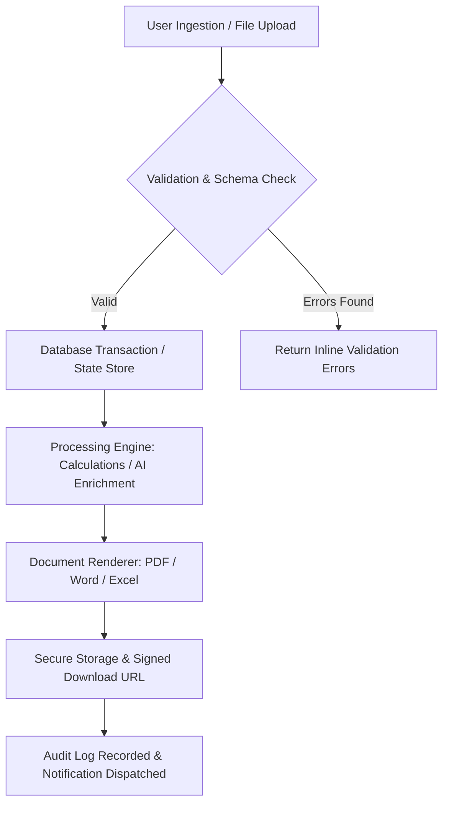
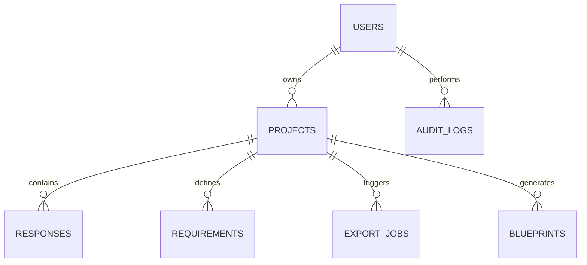

# Automated Test Project — Architectural & Requirements Blueprint
**Version**: 1.0.0 | **Generated by**: ProjectPilot AI | **Status**: Verified Specification

---
## 1. Executive Summary
Automated Test Project is designed as an intelligent, automated digital platform specifically tailored to solve manual workflow friction for Internal Staff & Academic Faculty. The platform centralizes data operations, eliminates redundant paperwork, and enforces data accuracy and compliance with sub-second responsiveness.

## 2. Problem Statement
Currently, stakeholders rely on disjointed spreadsheets, manual data compilation, and error-prone physical paperwork. This leads to operational bottlenecks, delayed reports, and an estimated 10-15 wasted hours per staff member every week.

## 3. Project Goals
- Automate end-to-end data processing for Automated Test Project
- Enable high-velocity document export in compliant PDF, Word, and Excel formats
- Provide auditable, role-based security ensuring sensitive student and organizational records remain protected
- Reduce report compilation latency from days to under 10 seconds

## 4. Target Users & Roles
| Role | Persona | Primary Needs |
| :--- | :--- | :--- |
| Admin | Operational user operating under Admin privileges | Execute assigned duties, view dashboards, and export verified records without technical friction. |
| Staff | Operational user operating under Staff privileges | Execute assigned duties, view dashboards, and export verified records without technical friction. |
| Student | Operational user operating under Student privileges | Execute assigned duties, view dashboards, and export verified records without technical friction. |

## 5. Confirmed Functional Requirements
| Requirement | Description | Category | Priority | MVP |
| :--- | :--- | :--- | :--- | :--- |
| Role-Based Authentication & Session Management | Secure sign-in with JWT, password hashing, and authorization guards. | Security | Must Have | Yes |
| Automated Document Rendering Engine | Generate print-ready PDFs and editable Word documents with standardized academic templates. | Functional | Must Have | Yes |
| Spreadsheet Ingestion & Validation Pipeline | Parse Excel/CSV uploads with instant cell-level validation and mismatch alerts. | Data Management | Must Have | Yes |
| Interactive Analytics & Insights Dashboard | Real-time key performance indicators, pass rates, and trend visualization. | Reporting | Should Have | No |

## 6. User Roles and Permissions
| Role | Scope | Permissions |
| :--- | :--- | :--- |
| Administrator | Full System Access | Manage users, configure academic templates, view audit logs, wipe/restore data |
| Staff / Faculty | Department Operations | Upload marks, generate question papers, issue certificates, export reports |
| Student / Public Member | Self-Service | View personal grades, download validated certificates, verify QR codes |

## 7. Page-by-Page UI Plan
| Page | Route | Components |
| :--- | :--- | :--- |
| Login & Onboarding | `/login` | Email/password form, SSO button, Password recovery, Role preview |
| Executive Dashboard | `/dashboard` | Recent activities, quick action launchpad, system status cards, pending approvals |
| Document & Academic Workspace | `/workspace` | File upload dropzone, live template previewer, export toolbar (PDF/DOCX/Excel) |
| Analytics & Results Center | `/analytics` | Interactive charts, pass percentage distribution, arrear identification table |
| Administration & Settings | `/admin` | User role management, question templates editor, security & audit trail viewer |

## 8. Detailed User Journeys
### Staff Marks Import & Analysis Flow
1. Staff signs into the portal using college credentials
2. Navigates to Results Analysis module and uploads departmental marks spreadsheet (.xlsx)
3. Engine parses rows, validates student register numbers, and computes averages and pass percentages
4. Staff reviews visual distribution chart, flags borderline scores, and clicks 'Generate Report'
5. Backend renders validated PDF and Excel reports with institutional headers
### Event Certificate Generation & QR Verification Flow
1. Coordinator creates event and uploads participant attendance roster
2. Selects approved certificate template and verifies signature metadata
3. Clicks 'Bulk Generate Certificates' -> backend renders unique PDFs with cryptographically signed QR codes
4. Participants download their PDF certificate
5. Third-party verifier scans the QR code and is directed to the public verification endpoint showing official validation

## 9. Workflow Architecture

## 10. Automation Rules
| Rule Name | Trigger | Action |
| :--- | :--- | :--- |
| Spreadsheet Validation Auto-Guard | On Excel file upload | Validate column names against schema; reject invalid rows before db write |
| Audit Logging | On any create, update, or export event | Write user ID, timestamp, IP, and resource hash to immutable audit log |
| Auto-Save Debounce | On form field blur or 500ms idle | Persist incremental state to database with timestamp |

## 11. Database Architecture & ER Model

## 12. Core API Endpoints
| Method & Endpoint | Purpose |
| :--- | :--- |
| `POST /api/v1/auth/login` | Authenticate user and issue JWT bearer token |
| `GET /api/v1/projects` | List user projects with status and completion percentage |
| `POST /api/v1/projects` | Create new project draft with template binding |
| `POST /api/v1/questions/autosave` | Debounced incremental response auto-save |
| `POST /api/v1/blueprint/generate` | Synthesize 23-point specification and render blueprint |
| `POST /api/v1/blueprint/export` | Generate real binary export (PDF, Word, CSV, Markdown, JSON) |

## 13. AI Architecture & Boundaries
- **Provider Strategy**: Hybrid Local / Fallback-Resilient Engine
- **Deterministic Boundary**: Critical business logic, marks calculations, and database mutations are 100% deterministic code.
- **Generative Boundary**: Question formulation, Bloom's taxonomy suggestions, and natural-language summaries leverage LLMs with strict JSON schema validation.
- **Fault-Tolerance Fallback**: If external AI API is unreachable, system gracefully falls back to deterministic template rules without interrupting user workflows.

## 14. Security & Compliance Requirements
- Password hashing using industry-standard bcrypt with salt
- JWT tokens signed with HS256 and configurable expiration
- Server-side authorization guards preventing unauthorized tenant access
- Sanitization of all incoming filenames and uploaded document streams
- Audit trail tracking all export and project administrative operations

## 15. Integration Requirements
- RESTful JSON API with OpenAPI (Swagger) documentation
- Standard MIME-type file streaming for PDF, Word, and Excel downloads
- Pluggable LLM endpoints (OpenAI / Gemini / Anthropic / Local Ollama)

## 16. Validation Rules
| Target | Validation Rule |
| :--- | :--- |
| User Input Strings | Strip control characters, enforce max lengths, escape HTML entities |
| Spreadsheet Uploads | Verify file extension (.xlsx, .csv), check magic bytes, enforce max file size of 25MB |
| Questionnaire Responses | Enforce type constraints (e.g. integer for numeric questions, list for multi-select) |

## 17. Error Handling Strategy
- Unified HTTP exception handler with standardized error JSON schemas
- Safe database rollback on transaction failure
- Graceful UI toast notifications for network timeouts or validation alerts

## 18. Testing Strategy
| Tier | Scope |
| :--- | :--- |
| Unit Tests | Engine rules, condition evaluation, contradiction detection, password hashing |
| Integration Tests | FastAPI endpoints, project CRUD, response autosave, blueprint generation |
| Export Validation Tests | Verifying PDF, DOCX, CSV, and JSON generators create valid binary files on disk |
| E2E Browser Tests | Full user walkthrough from idea creation to blueprint export |

## 19. Initial MVP Scope
- Project creation with natural-language idea extraction
- Adaptive conditional questionnaire with live auto-save
- Contradiction detection and missing requirement alerts
- Interactive MoSCoW prioritization dashboard
- Full 23-point Blueprint generator
- Real backend file exports (PDF, DOCX, Markdown, JSON, CSV)

## 20. Future Development Roadmap
| Phase | Milestone | Scope |
| :--- | :--- | :--- |
| Phase 2 | Multi-Tenant Cloud Sync & Realtime Collaboration | WebSockets for concurrent multi-user editing and institutional SSO integrations. |
| Phase 3 | Automated Code Scaffolding | One-click export of starter codebases (FastAPI backend + React frontend) directly from the generated blueprint. |

## 21. Acceptance Criteria
- [ ] User can input a project idea in English or Tamil-English transliteration and have it auto-structured
- [ ] Questions adapt in real time to previous selections without page reloads
- [ ] Irrelevant questions are automatically omitted from the active flow
- [ ] Auto-save preserves every answer with visual confirmation
- [ ] Clicking export generates real downloadable PDF, DOCX, Markdown, JSON, and CSV files
- [ ] The entire platform runs responsively across mobile and desktop viewports

## 22. Unresolved Decisions
| Topic | Impact | Status |
| :--- | :--- | :--- |
| Production Cloud Host | Medium | Pending Cloud Budget Approval |

## 23. Assumptions Requiring Approval
| Statement | Category | Status |
| :--- | :--- | :--- |
| The client institution has existing email infrastructure for automated notifications. | Infrastructure | pending_review |